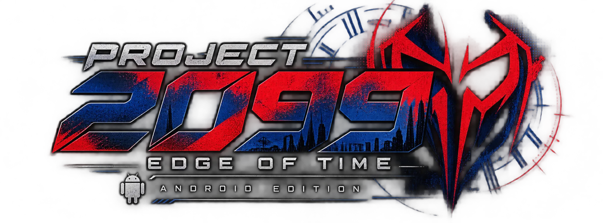
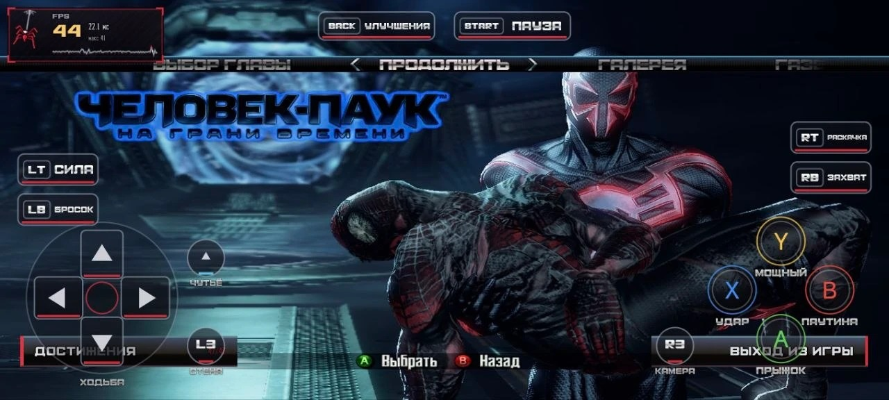
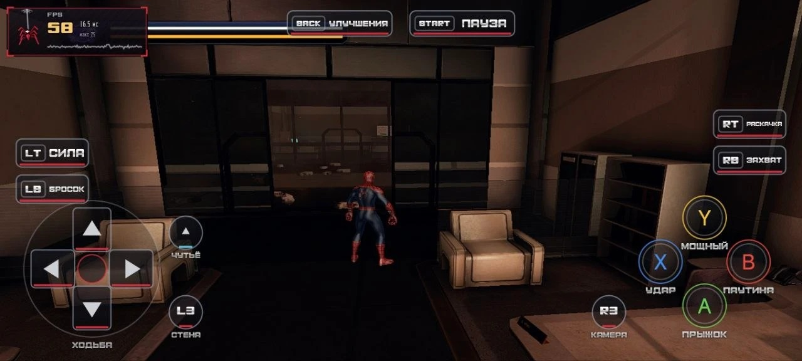
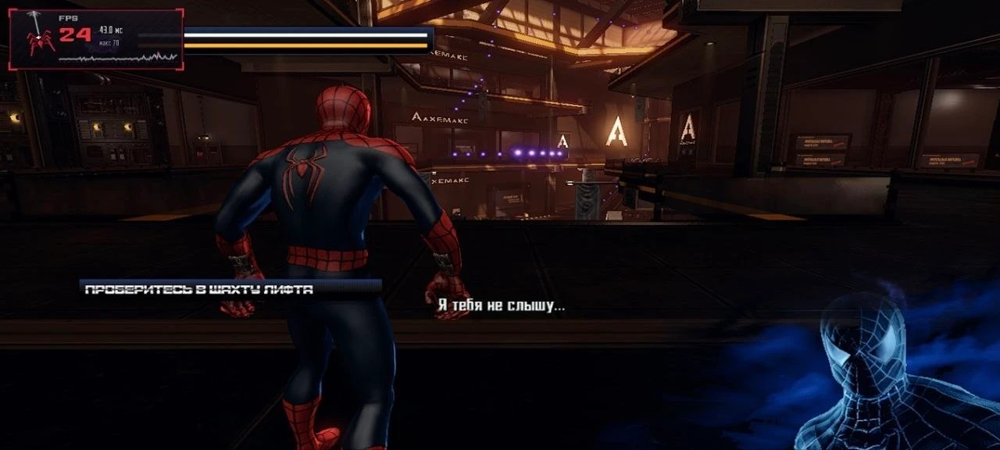

# Project 2099 — Android

**Русский** · [English](#english) · [← Project 2099 для ПК](README.md)

> Без цензуры: я, блять, это сделал. Spider-Man: Edge of Time с Xbox 360 теперь на телефоне — **не эмулятор**, а родной порт: игра перекомпилирована под ARM и рисует через Vulkan. Тот же Project 2099, что на ПК: русская версия, ремастер, кровь, новые костюмы, достижения — только в кармане, сука.
>
> Это **первая бета**. Проверена на POCO X7 Pro (Dimensity 8400, Mali-G720, 8 ГБ). На других телефонах может и выебываться — пишите, разберёмся.

Связь — [Telegram](https://t.me/teamgenrythefox) и [Discord](https://discord.gg/2Yy45gJap3).

  
  

## Что нужно

- Android 11 или новее, 64-битный процессор (arm64), Vulkan 1.3.
- 8 ГБ оперативки — рекомендую; на 6 ГБ пойдёт, но тяжёлые места будут подтормаживать.
- Своя копия игры (Xbox 360): ISO, ZIP, GOD или распакованная папка. Файлов игры здесь нет и не будет.
- Место на телефоне: ~6 ГБ на одно издание (русское или оригинал), ~12 ГБ на оба; 4K-ремастер при установке ужимается под телефон.

## Как поставить

1. Скачай **Project2099-Android-Beta1.apk** из [релизов](https://github.com/GenryTheFox0/Project-2099/releases/tag/android-v1.0.0-beta.1) и установи.
2. На ПК поставь игру установщиком **[Беты 5](https://github.com/GenryTheFox0/Project-2099/releases/tag/v2.0.0-beta.5)** (`Project2099-Beta5-Setup.exe`) из своего образа — так же, как для ПК-версии. 4K-ремастер можно ставить: на телефоне он сам ужмётся.
3. Скопируй из папки игры на ПК папки **Data** и **Mods** на телефон (например, в «Загрузки/Project2099»).
4. Открой Project 2099 на телефоне → **УСТАНОВИТЬ ИГРУ** → **ВЫБРАТЬ ПАПКУ** → укажи эту папку. Всё встанет само, потом копию можно удалить.

Можно и без шага 4: скопируй Data и Mods сразу в `Android/data/org.genry.project2099/files/Project2099`.

## Что внутри

- Лаунчер как на ПК: вступительный фильм с озвучкой, временной портал, 6 языков, русская версия или оригинал на 5 языках.
- Экранные кнопки в стиле EOT (стрелки — ходьба, подписи действий); геймпады по Bluetooth и USB работают сразу, кнопки прячутся.
- Все окна Project 2099: настройки (с вкладкой «ТЕЛЕФОН»), достижения, VIP-коды, подтверждения — под палец и геймпад, без клавомышиного говна, пока клаву не подключишь.
- 4K-ремастер персонажей и костюмов (под телефон — до 1024), облики Питера и Мигеля, кровь и урон, 9 новых костюмов, моды.
- Под телефон: ограничение FPS 30/40/60/120, подсказки процессору (ADPF), сборка шейдеров в фоне, экономия батареи.

## Известные косяки беты

- Первые запуски уровней подтормаживают — телефон собирает шейдеры, потом запоминает.
- В самых тяжёлых местах (лазеры, переходы) FPS может проседать — особенно на 6 ГБ памяти и при нагреве на зарядке.
- Проверено только на Mali (MediaTek). Adreno (Snapdragon) не проверял — отпишитесь, как идёт.

## Авторы

- Project 2099 и порт на Андроид — **GenryTheFox**.
- Движок reeot — **Graine25**: [EdgeOfTimeRecomp](https://github.com/goliathret/EdgeOfTimeRecomp). На нём держится всё.
- Лицензии всех компонентов — в папке [licenses/android](licenses/android).

Игра принадлежит Activision и Marvel. Это неофициальный фанатский проект; нужна своя копия игры.

---

## English

> No censorship: I fucking did it. Spider-Man: Edge of Time from the Xbox 360 now runs on a phone — **not an emulator**, a native port: the game is recompiled for ARM and draws through Vulkan. The same Project 2099 as on PC: the Russian edition, the remaster, blood, new suits, achievements — just in your pocket.
>
> This is the **first beta**. Tested on a POCO X7 Pro (Dimensity 8400, Mali-G720, 8 GB). Other phones may act up — report it and we'll sort it out.

Contact — [Telegram](https://t.me/teamgenrythefox) and [Discord](https://discord.gg/2Yy45gJap3).

### Requirements

- Android 11 or newer, a 64-bit (arm64) CPU, Vulkan 1.3.
- 8 GB of RAM recommended; 6 GB works, but heavy scenes will stutter.
- Your own copy of the game (Xbox 360): ISO, ZIP, GOD or an extracted folder. No game files are here and never will be.
- Free space: ~6 GB per edition (Russian or Original), ~12 GB for both; the 4K remaster is cut to the phone's size on install.

### How to install

1. Download **Project2099-Android-Beta1.apk** from the [releases](https://github.com/GenryTheFox0/Project-2099/releases/tag/android-v1.0.0-beta.1) and install it.
2. On a PC, install the game with the **[Beta 5](https://github.com/GenryTheFox0/Project-2099/releases/tag/v2.0.0-beta.5)** installer (`Project2099-Beta5-Setup.exe`) from your own dump — the same as for the PC version. The 4K remaster is fine: the phone cuts it down itself.
3. Copy the **Data** and **Mods** folders from the game's folder on the PC to the phone (for example to Downloads/Project2099).
4. Open Project 2099 on the phone → **INSTALL THE GAME** → **PICK THE FOLDER** → choose that folder. It installs itself; the copy can be deleted afterwards.

Or skip step 4: copy Data and Mods straight into `Android/data/org.genry.project2099/files/Project2099`.

### What's inside

- A launcher like the PC one: the intro film with its voice-over, the time portal, 6 languages, the Russian edition or the Original in 5 languages.
- On-screen buttons in the EOT style (arrows to walk, labelled actions); Bluetooth and USB gamepads work right away and hide the buttons.
- Every Project 2099 window: settings (with a PHONE tab), achievements, VIP codes, confirmations — made for a finger and a gamepad, with no keyboard-and-mouse crap until you plug a keyboard in.
- The 4K remaster of characters and suits (up to 1024 on a phone), Peter's and Miguel's looks, blood and damage, 9 new suits, mods.
- For phones: a 30/40/60/120 FPS cap, CPU performance hints (ADPF), background shader builds, a battery saver.

### Known beta issues

- The first runs of a level stutter — the phone builds its shaders, then remembers them.
- The heaviest scenes (lasers, transitions) can drop frames — especially with 6 GB of RAM and a hot phone on the charger.
- Tested on Mali (MediaTek) only. Adreno (Snapdragon) is untested — tell us how it goes.

### Credits

- Project 2099 and the Android port — **GenryTheFox**.
- The reeot engine — **Graine25**: [EdgeOfTimeRecomp](https://github.com/goliathret/EdgeOfTimeRecomp). Everything stands on it.
- The licenses of every component are in the [licenses/android](licenses/android) folder.

The game belongs to Activision and Marvel. This is an unofficial fan project; you need your own copy of the game.
